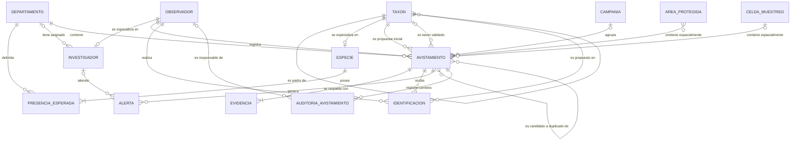

# Modelo conceptual

El modelo conceptual representa las entidades principales del sistema de ciencia ciudadana de biodiversidad y las relaciones existentes entre ellas, independientemente de su posterior implementación en un sistema gestor de bases de datos.

## Entidades

### Taxón

Representa una unidad de la clasificación biológica. Los taxones forman una estructura jerárquica mediante una relación recursiva que permite representar reino, filo, clase, orden, familia, género y especie.

### Especie

Representa la especialización de aquellos taxones cuyo rango corresponde a especie. Contiene la información propia de este nivel, como nombre común, estado de conservación, condición endémica y condición migratoria.

La especialización `Taxón → Especie` es **parcial**, ya que no todos los taxones son especies.

### Presencia esperada

Representa las condiciones geográficas y temporales en las que se espera encontrar una especie.

Una especie posee una o más condiciones de presencia esperada, permitiendo establecer diferentes temporadas de presencia según el departamento.

Esta información constituye la referencia utilizada para detectar avistamientos fuera de rango geográfico o temporal.

### Observador

Representa a una persona registrada en la plataforma. Puede registrar avistamientos, realizar identificaciones sobre observaciones de otros usuarios y acumular reputación por sus contribuciones.

### Investigador

Representa una especialización de Observador con responsabilidad de revisión especializada.

La especialización `Observador → Investigador` es **parcial**, debido a que un observador puede participar en la plataforma sin ser investigador.

Un investigador puede ser asignado a un departamento para atender los casos que requieran revisión especializada dentro de dicha zona.

### Avistamiento

Representa una observación de biodiversidad realizada por un observador en un lugar y momento determinados.

Conserva conceptualmente la propuesta taxonómica inicial realizada por su autor y puede adquirir posteriormente un taxón validado como resultado del consenso comunitario o de la revisión especializada realizada por un investigador.

Constituye la entidad central del modelo.

### Evidencia

Representa el material multimedia que respalda un avistamiento, como fotografías o audios.

Todo avistamiento debe estar respaldado por al menos una evidencia y cada evidencia pertenece exclusivamente a un avistamiento.

### Identificación

Representa una propuesta taxonómica realizada por un observador sobre un avistamiento registrado por otro usuario.

Las identificaciones permiten determinar mediante consenso comunitario el taxón correspondiente a un avistamiento.

Un mismo observador puede mantener como máximo una identificación para un mismo avistamiento; si modifica su propuesta, se actualiza dicha identificación. El autor del avistamiento no puede identificar su propio registro.

### Departamento

Representa una división territorial utilizada para organizar geográficamente los avistamientos, establecer la presencia esperada de especies y asignar investigadores.

La ubicación de un avistamiento permite determinar el departamento en el que ocurrió.

### Área protegida

Representa un territorio sujeto a protección, como una reserva o parque.

La relación entre un área protegida y un avistamiento se determina mediante la ubicación geográfica de este último.

Por tratarse de una relación espacial, su representación conceptual no implica necesariamente almacenar posteriormente una relación explícita entre ambas entidades.

### Celda de muestreo

Representa una unidad perteneciente a una grilla espacial utilizada para analizar la distribución de las observaciones y detectar zonas con ausencia o baja intensidad de muestreo.

Un avistamiento puede encontrarse espacialmente dentro de una celda de muestreo.

### Campaña

Representa una jornada o período organizado de observación de biodiversidad.

Una campaña puede agrupar múltiples avistamientos, mientras que un avistamiento puede pertenecer como máximo a una campaña o realizarse independientemente.

### Alerta

Representa una condición detectada por el sistema que requiere atención especializada.

Una alerta puede originarse, entre otros motivos, porque el avistamiento corresponde a una especie amenazada, se encuentra fuera de la distribución geográfica esperada o se produjo fuera de la temporada esperada.

Una alerta puede permanecer sin investigador responsable y queda disponible para los investigadores asignados al departamento correspondiente hasta que uno de ellos asuma su revisión.

### Candidato a duplicado

Representa conceptualmente la relación entre dos avistamientos que podrían corresponder al mismo evento de observación.

La relación se determina mediante criterios taxonómicos, espaciales y temporales, es simétrica y nunca puede relacionar un avistamiento consigo mismo.

La relación posee información propia, como la distancia entre ambos registros, la diferencia temporal y el estado de evaluación del posible duplicado.

### Auditoría de avistamiento

Representa el historial inmutable de los cambios de estado de un avistamiento.

Permite conocer el estado anterior, el nuevo estado, el momento del cambio y, cuando corresponda, el observador responsable.

Los cambios realizados automáticamente por el sistema también forman parte de la auditoría, aunque en estos casos no existe un observador responsable.

## Relaciones conceptuales principales

- Un taxón puede contener múltiples taxones inferiores y puede depender de un taxón superior.
- Un taxón puede especializarse en una especie.
- Una especie posee una o más condiciones de presencia esperada.
- Cada condición de presencia esperada corresponde a un departamento.
- Un observador puede especializarse en investigador.
- Un investigador puede estar asignado a un departamento.
- Un observador puede registrar múltiples avistamientos.
- Todo avistamiento posee exactamente una propuesta taxonómica inicial.
- Un avistamiento puede adquirir posteriormente un taxón validado, obtenido por consenso comunitario o por revisión especializada.
- Todo avistamiento posee una o más evidencias.
- Un observador puede realizar múltiples identificaciones.
- Un avistamiento puede recibir múltiples identificaciones.
- Cada identificación propone exactamente un taxón.
- Todo avistamiento ocurre en un departamento.
- Un avistamiento puede pertenecer como máximo a una campaña.
- Un avistamiento puede generar múltiples alertas.
- Una alerta puede ser atendida por un investigador.
- Un área protegida puede contener espacialmente múltiples avistamientos.
- Una celda de muestreo puede contener espacialmente múltiples avistamientos.
- Un avistamiento puede ser candidato a duplicado de múltiples avistamientos.
- Un avistamiento puede generar múltiples registros históricos de auditoría.
- Un registro de auditoría puede tener un observador responsable o haber sido generado automáticamente por el sistema.

## Restricciones conceptuales relevantes

1. Solo los taxones cuyo rango sea especie pueden participar como `Especie`.
2. Toda especie debe poseer al menos una condición de presencia esperada.
3. Todo avistamiento debe poseer al menos una evidencia.
4. El autor de un avistamiento no puede realizar una identificación comunitaria sobre su propio avistamiento.
5. Un observador puede mantener como máximo una identificación sobre el mismo avistamiento; si cambia su propuesta, se actualiza dicha identificación.
6. Un avistamiento puede existir sin taxón validado mientras se encuentre en proceso de validación.
7. Un investigador es siempre un observador, pero no todo observador es investigador.
8. Un avistamiento puede existir sin pertenecer a una campaña.
9. Una alerta puede existir temporalmente sin investigador asignado y ser asumida únicamente por un investigador del departamento correspondiente.
10. Un avistamiento no puede ser candidato a duplicado de sí mismo.
11. La relación de duplicidad entre avistamientos es simétrica.
12. La pertenencia a áreas protegidas y celdas de muestreo se determina espacialmente.
13. Los registros de auditoría no pueden modificarse ni eliminarse una vez creados.
14. Los cambios automáticos de estado deben distinguirse de aquellos realizados por personas.
