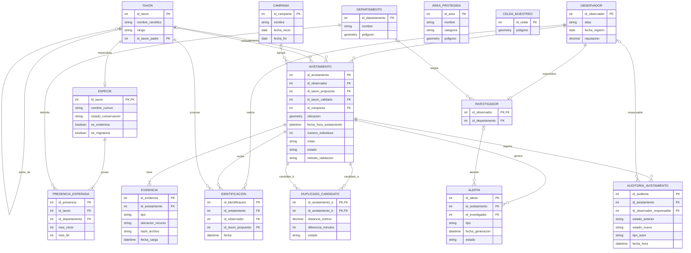

# Modelo lógico

El modelo lógico transforma las entidades y relaciones definidas en el modelo conceptual en estructuras relacionales, especificando atributos, claves primarias, claves foráneas y restricciones necesarias para preservar las reglas de negocio.

## Diagrama lógico

# Descripción de las relaciones

## `taxon`

**PK:** `id_taxon`

**FK:** `id_taxon_padre → taxon.id_taxon`

Contiene toda la jerarquía taxonómica mediante una relación autorreferenciada.

`id_taxon_padre` puede ser nulo únicamente para los taxones raíz.

---

## `especie`

**PK/FK:** `id_taxon → taxon.id_taxon`

Implementa la especialización parcial `Taxón → Especie`.

Solo puede existir una fila en `especie` cuando el taxón correspondiente posee rango de especie.

Al utilizar `id_taxon` simultáneamente como PK y FK se garantiza una relación uno a uno entre el taxón y su información específica.

---

## `presencia_esperada`

**PK:** `id_presencia`

**FK:**
- `id_taxon → especie.id_taxon`
- `id_departamento → departamento.id_departamento`

Representa la distribución geográfica y temporal esperada de una especie.

Una especie puede tener varias condiciones de presencia, permitiendo establecer diferentes períodos esperados para distintos departamentos.

`mes_inicio` y `mes_fin` representan el intervalo anual esperado y permiten modelar períodos que atraviesen el cambio de año, por ejemplo noviembre-febrero.

---

## `observador`

**PK:** `id_observador`

Representa a todos los usuarios participantes de la plataforma.

La reputación pertenece al observador independientemente de que este sea o no investigador.

---

## `investigador`

**PK/FK:** `id_observador → observador.id_observador`

**FK:** `id_departamento → departamento.id_departamento`

Implementa la especialización parcial `Observador → Investigador`.

La existencia de una fila en esta relación determina que un observador desempeña la función de investigador, por lo que deja de ser necesario almacenar un atributo `rol` dentro de `observador`.

`id_departamento` puede ser nulo mientras el investigador todavía no tenga una zona asignada.

---

## `avistamiento`

**PK:** `id_avistamiento`

**FK:**
- `id_observador → observador.id_observador`
- `id_taxon_propuesto → taxon.id_taxon`
- `id_taxon_validado → taxon.id_taxon`
- `id_campania → campania.id_campania`

`id_observador` e `id_taxon_propuesto` son obligatorios.

`id_taxon_validado` es opcional mientras el avistamiento no haya finalizado su proceso de validación.

`id_campania` también es opcional porque los avistamientos pueden registrarse independientemente de una campaña.

La propuesta inicial se mantiene separada del taxón validado para conservar el dato original incluso cuando posteriormente sea corregido.

`metodo_validacion` es opcional inicialmente y, cuando existe un taxón validado, indica si este se obtuvo por `consenso` o por `investigador`.

El departamento no se almacena como FK en `AVISTAMIENTO`; se determina espacialmente a partir de `ubicacion` y del polígono de `DEPARTAMENTO`.

---

## `evidencia`

**PK:** `id_evidencia`

**FK:** `id_avistamiento → avistamiento.id_avistamiento`

Cada evidencia pertenece exactamente a un avistamiento.

`tipo` permite distinguir fotografía, audio u otros formatos admitidos.

`ubicacion_recurso` permite localizar el archivo almacenado externamente, mientras que `hash_archivo` permite verificar su identidad y detectar la reutilización del mismo material.

---

## `identificacion`

**PK:** `id_identificacion`

**FK:**
- `id_avistamiento → avistamiento.id_avistamiento`
- `id_observador → observador.id_observador`
- `id_taxon_propuesto → taxon.id_taxon`

Representa las propuestas de identificación realizadas por la comunidad.

Debe establecerse una restricción:

`UNIQUE (id_avistamiento, id_observador)`

para impedir que un observador mantenga más de una identificación para el mismo avistamiento. Si modifica su propuesta, se actualiza la identificación existente.

También debe garantizarse que `id_observador` sea diferente del autor del avistamiento correspondiente.

---

## `departamento`

**PK:** `id_departamento`

Representa las divisiones territoriales utilizadas por el sistema.

Su geometría permite determinar espacialmente en qué departamento ocurrió un avistamiento.

La relación entre `DEPARTAMENTO` y `AVISTAMIENTO` se determina espacialmente a partir de la ubicación del avistamiento y del polígono territorial.

---

## `area_protegida`

**PK:** `id_area`

Representa las áreas geográficas protegidas.

No requiere una FK directa con `avistamiento`, ya que su relación se obtiene mediante operaciones espaciales entre el punto del avistamiento y el polígono del área.

---

## `celda_muestreo`

**PK:** `id_celda`

Representa las unidades de la grilla utilizada para los análisis espaciales.

Tampoco requiere una FK desde `avistamiento`, porque la pertenencia a una celda se determina espacialmente.

---

## `campania`

**PK:** `id_campania`

Define los períodos organizados de observación.

Debe cumplirse:

`fecha_inicio <= fecha_fin`

---

## `alerta`

**PK:** `id_alerta`

**FK:**
- `id_avistamiento → avistamiento.id_avistamiento`
- `id_investigador → investigador.id_observador`

`id_investigador` puede ser nulo mientras la alerta no haya sido asumida. La alerta queda disponible para los investigadores asignados al departamento correspondiente y, cuando uno de ellos asume la revisión, queda registrado como responsable.

El atributo `tipo` permite distinguir, como mínimo:

- especie amenazada;
- fuera de distribución geográfica;
- fuera de temporada.

Un mismo avistamiento puede generar varias alertas de diferentes tipos.

---

## `duplicado_candidato`

**PK compuesta:**
- `id_avistamiento_a`
- `id_avistamiento_b`

**FK:**
- `id_avistamiento_a → avistamiento.id_avistamiento`
- `id_avistamiento_b → avistamiento.id_avistamiento`

La tabla implementa la relación muchos a muchos autorreferenciada entre avistamientos.

Debe cumplirse:

`id_avistamiento_a <> id_avistamiento_b`

Además, el sistema debe almacenar cada pareja en un único orden para impedir que `(A,B)` y `(B,A)` representen dos veces la misma relación.

Una regla posible es:

`id_avistamiento_a < id_avistamiento_b`

La relación también conserva la distancia espacial y la diferencia temporal que justificaron la detección.

---

## `auditoria_avistamiento`

**PK:** `id_auditoria`

**FK:**
- `id_avistamiento → avistamiento.id_avistamiento`
- `id_observador_responsable → observador.id_observador`

`id_observador_responsable` puede ser nulo cuando el cambio haya sido realizado automáticamente.

`tipo_actor` permite diferenciar, como mínimo:

- observador;
- investigador;
- sistema.

Los registros son históricos e inmutables.

# Restricciones lógicas principales

1. `taxon.id_taxon_padre` no puede referenciar al mismo taxón.
2. Solo un taxón de rango especie puede poseer una fila en `especie`.
3. Toda especie debe poseer al menos una presencia esperada.
4. Los meses de `presencia_esperada` deben encontrarse entre 1 y 12.
5. Todo avistamiento debe poseer al menos una evidencia.
6. `numero_individuos` debe ser mayor que cero.
7. `id_taxon_validado` puede ser nulo mientras el avistamiento no haya finalizado su proceso de validación.
8. Si existe `id_taxon_validado`, debe existir también `metodo_validacion`.
9. `metodo_validacion` solo puede tomar los valores `consenso` o `investigador`.
10. `id_campania` puede ser nulo.
11. Un observador solo puede tener una identificación por avistamiento.
12. El autor de un avistamiento no puede identificar su propio avistamiento.
13. Una alerta puede existir sin investigador asignado.
14. El investigador que asuma una alerta debe corresponder al territorio responsable del avistamiento.
15. `campania.fecha_inicio` no puede ser posterior a `campania.fecha_fin`.
16. Un avistamiento no puede ser candidato a duplicado de sí mismo.
17. Una pareja de candidatos a duplicado solo puede almacenarse una vez.
18. Los registros de auditoría son inmutables.
19. Un cambio automático de estado debe identificarse como realizado por el sistema.
20. El departamento de un avistamiento debe corresponder espacialmente con su ubicación.
